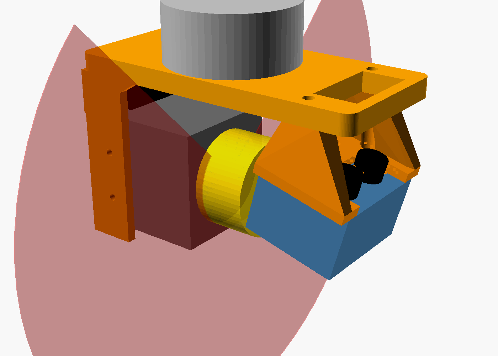
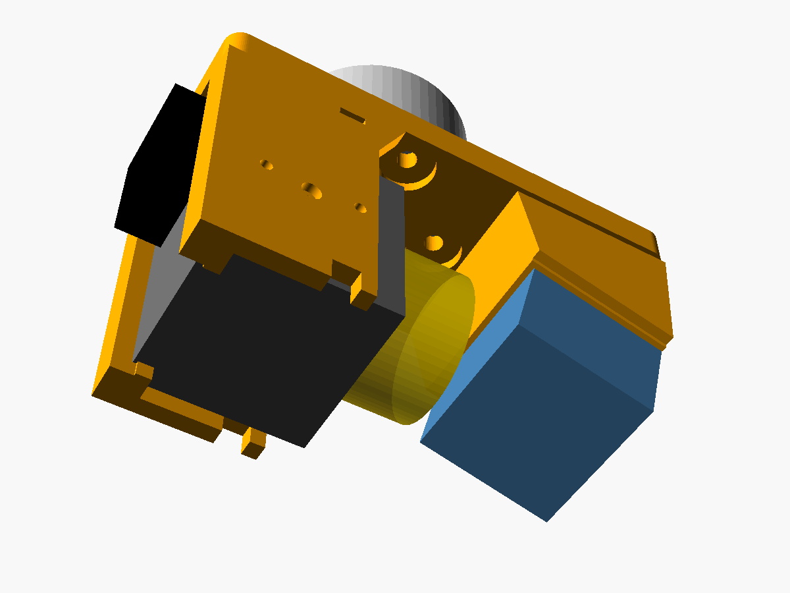
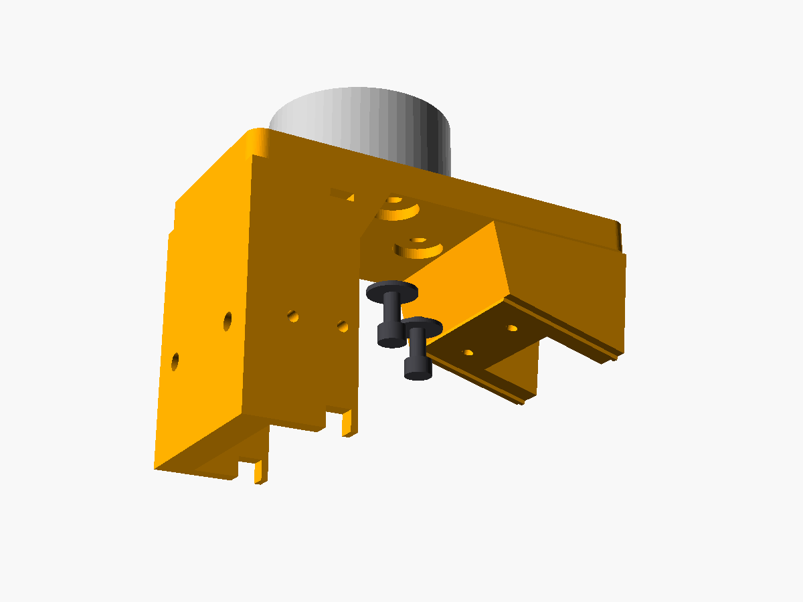

# TiM + SEC110 tool mount for the Lexium Cobot

This is a 3D-printable mount for the LXMRL03 tool flange (JAKA Zu 3: 4 × M6 on Ø50, Ø6 pin). It carries:
- a **SICK TiM5xx/7xx** 2D LiDAR (TiM561/571/781 all use the same housing)
- a **SICK sensingCam SEC110** camera

The design is one parametric OpenSCAD file, [tim_sec_mount.scad](tim_sec_mount.scad). The printable STLs are in [stl/](stl/).



| From the camera end | From below (belt side) |
|---|---|
|  |  |

**How the TiM sits:**
- It lies **on its side**: hood axis along the flange's X axis (the direction of travel), front face down at the belt, connectors up towards the arm.
- A TiM scans in the plane at right angles to its hood axis, so this makes the 270° fan stand **across the belt**, through the flange axis.
- Its 90° blind sector (around the connectors) faces the arm, so the fan never sees the robot.
- The scan origin is **X 0, Y 0, Z 62.5 mm** from the flange face. The app's Scan tab uses the same value for tool slot 1.

**The camera** sits on a solid block under the other end of the same part, looking down and tilted 15° back towards the scan line.


**One printed part holds both sensors**, and nothing relies on friction alone:
- **TiM:** it sits in a box cradle:
  - side walls (±Y)
  - base posts (−X)
  - two ledges under its front face (+Z)
  - back pads (−Z)

  It's fixed with **2 × M3 screws into the TiM's own side threads** (SICK's mounting points). There are also 4 nylon-tipped set screws against rattle, and a slot for a backup strap.
- **SEC110:** a seat with a locating rim on three sides, and 2 × M4 screws into the camera's back, driven from the top of the plate.

**Strength:** see the [structural analysis](analysis/README.md). In summary:
- 4.6× lower stress than the old two-piece design.
- Layers would separate at about 43 g. A protective stop is about 6 g.
- The TiM moves 20 µm per g sideways.
- The lowest natural frequency is about 115 Hz.
- The weak points are the fasteners, sized in that report.

## Parts

| STL | Print | Time (estimate, not sliced) |
|---|---|---|
| `fit_test.stl` | flat, no supports | about 25 min. **Print this first.** |
| `mount.stl` | flange face on the bed (as exported), no supports | about 8–10 h |

- **Material:** PETG, or ASA near heat. Not PLA: it creeps when it's warm, and the sensors and the arm get warm.
- **Settings:** 0.2 mm layers, **6 walls**, 5 top and bottom layers, 50 % gyroid infill. Turn the cooling fan down so the layers bond well: the layers are the weak direction.
- **Bridges:** the only unsupported spans are the strap slot (9 mm), the ledges (6 mm, held on two sides) and small hole ceilings. They print without supports.
- **Holes:** they are drawn to size. If your printer prints holes small, ream the Ø6 pin hole and drill out the M6 holes.

## Ready-to-print project (Bambu Lab A1 mini)

[print/tim_sec_mount_A1mini_PETG.3mf](print/tim_sec_mount_A1mini_PETG.3mf) is a sliced Bambu Studio project with two plates. Print them in order:

| Plate | Part | Time | PETG |
|---|---|---|---|
| 1 | `fit_test.stl`: check the holes and the TiM width on the real arm first | 47 min | 18 g |
| 2 | `mount.stl`: the one-piece mount, flange face on the bed | 10 h 21 min | 245 g |

Those are the only two printed parts. Everything else is bought hardware: see [Hardware](#hardware).

**Settings:**
- Bambu Lab A1 mini, 0.4 mm nozzle, textured PEI plate.
- Bambu PETG Basic at 245 °C, bed at 70 °C.
- 0.20 mm layers, 6 walls, 5 top and bottom layers, 50 % gyroid infill, no supports.
- Part fan lowered to 15–30 % so the layers bond better.

The profiles are in `print/`. To slice again after a change, from this folder:

```bash
BambuStudio.AppImage --load-settings "machine.json;print/process_strong_mount_A1M.json" --load-filaments print/filament_PETG_A1M_lowfan.json \
  --load-assemble-list print/assemble.json --curr-bed-type "Textured PEI Plate" --slice 0 --export-3mf print/tim_sec_mount_A1mini_PETG.3mf
```

`machine.json` is the Bambu Lab A1 mini 0.4 nozzle system profile, with its `inherits` chain merged into one file.

## Fit test: print it first


A 5 mm ring with the mount's flange holes, plus a 12 mm high gauge as wide as the TiM cradle, all in one piece. It uses the same values as the mount, so if it fits, the mount fits. Print it in the same material and settings you'll use for the mount, then check:

| Check | Pass |
|---|---|
| Lay the ring on the flange, Ø6 dowel in the pin hole | all four M6 holes line up with the flange's threads; the dowel goes in by hand (snug, no wobble) |
| Screw in four M6 screws | they go in without forcing the ring sideways |
| Ø18 washer in the large counterbore | it drops in and sits flat |
| Look through the Ø32 centre hole | the flange's centring recess shows evenly all round (the ring is centred) |
| M3 insert in the plain Ø4 hole | it presses in straight and holds |
| M3 screw in the counterbored Ø3.4 hole, M4 in the counterbored Ø4.4 hole | the screws pass freely and the heads sit below the surface |
| Slide the TiM between the gauge's two walls | it slides in with a little play (0.4 mm a side) |

If a hole is tight, change `fl_bolt`, `fl_pin` or the insert sizes. If the TiM is tight or loose, change `clr`. Then export again and reprint the fit test before the mount.

## Hardware

| Qty | Part | Where |
|---|---|---|
| 4 | M6 × 16 socket head, 8.8 | mount to the flange: 8 mm of plastic under the washer, 6.4 mm into the flange's 7 mm threads. **3 Nm**, not the 11 Nm rated for metal tools. Medium threadlocker on the steel threads only. |
| 4 | M6 DIN 9021 washers (Ø18) | under the heads, in the Ø19 counterbores. They keep the pressure on the plastic down to 11 MPa, so it doesn't creep and loosen. |
| 1 | Ø6 × 16 dowel pin | in the pin hole: 7 mm in the plate, 9 mm in the flange. It sets the rotation. |
| 2 | M3 × 6 socket head | through the side walls into the TiM's M3 threads (2.8 mm deep). 0.5 Nm (SICK's maximum is 0.8 Nm). If the thread sits in a recess, use the length that puts 2–2.5 mm of screw into it. |
| 4 | M3 heat-set inserts (Ø4.0 hole) + M3 × 8 nylon-tipped set screws | against rattle: snug, not tight |
| 1 | cable tie or hook-and-loop strap, 8 mm wide | backup: through the slot above the TiM, round its front face |
| 2 | M4 × 8 socket head | SEC110 to its seat, from the top of the plate: 5 mm of plastic under the head, 3 mm into the camera. You need a long 3 mm hex key (the holes are about 45 mm deep). |
| 2 | **straight** M12 cables | SEC110: Ethernet (4-pin D-coded) and power/I/O (4-pin A-coded). They go up through the channel, which is open at the end. |
| 2 | M12 cables | TiM: through the window between the base posts |

## Assembly

| 1. Bolt the mount to the flange | 2. TiM: up from below, then back onto the ledges |
|---|---|
|  |  |
| **3. TiM screws, set screws, strap** | **4. Camera: up into its rim, M4 screws from the top** |
|  |  |

`stl/assembly_view.3mf` opens the whole assembly in a slicer as one object with five parts: the mount, the flange, the TiM, the camera, and the screws with the strap. It's for looking at only, so print `mount.stl`. Rebuild it with `analysis/make3mf.py` from the `p_*` parts of the .scad.


1. Press the four M3 inserts into the side walls.
2. Fit the dowel. Bolt the mount to the flange: 4 × M6 × 16 with the Ø18 washers, 3 Nm in a cross pattern. Do this first: the bolt heads are reached from below, before the sensors go in.
3. **TiM:**
   - Hold it under the cradle, 8 mm towards the camera end, and push it straight up until its back touches the pads.
   - Slide it back towards the base posts, so its front face rests on the two ledges and its connector unit sits in the window.
   - Screw the two M3 × 6 through the side walls into its threads (0.5 Nm), then snug the four set screws.
   - Thread the strap through the slot and round the TiM's front face.
   - The `check_insert` collision check confirms there's room for this path.
4. **SEC110:** plug in its straight M12 cables first. Lay them in the channel, set the camera into the rim (connectors towards the open end), and screw in the 2 × M4 × 8 from the top of the plate.
5. Plug in the TiM's cables through the window.
6. In the app: Scan tab → **scanner on the flange**. In the simulator that sets tool slot 1 (Z 62.5) and the payload: 0.68 kg, centre of mass X 7, Y 0, Z 44 mm. On the real cobot, enter the same values in Setup → Tool and Payload.

## Check before trusting it

- **Fan direction:** the bolt pattern is symmetric, so it doesn't say which way the robot's own tool X points. After mounting, jog in Tool X and check the arm moves along the TiM's hood axis. If not, add the difference to the pass **Direction**, or turn the tool frame.
- **TiM screw holes:** the M3 holes are placed from the datasheet drawing (24.4 mm above the base, 33 mm from the back). Check them against your TiM before tightening. If they don't line up, the TiM is still boxed in by the ledges, pads and walls, and the strap holds it.
- **TiM front face:** the ledges and the strap touch the front face near the base end. Check they don't cover anything you need to see, such as status LEDs.
- **TiM side faces:** the datasheet drawing shows a 0.7 mm step on the lower housing. The set screws take up the difference, but if the TiM rocks in the cradle, check the clearance (`clr`).
- **Camera focus:** the SEC110's working distance starts at **0.3 m**. Its lens sits about 16 mm lower than the TiM's scan origin, so the Scan tab's default pass height of 330 mm keeps the belt just over 0.3 m away. Don't scan lower than about 320 mm if you need the camera image. The L03 reaches a 330 mm pass at X 250–340 mm.
- **Not confirmed:** the SEC110 M4 thread depth (hence 3 mm of screw in it), and where the arm's M8 tool connector sits around the flange (it's on the side of joint 6, and the plate stays within 36 mm of the axis at Y).

## Collision checks

The .scad file has check parts that intersect two things that must never touch. Each must come out empty (OpenSCAD then says *Current top level object is empty*):

| Check | What must not touch |
|---|---|
| `check_tim` | the mount and the TiM (body, hood, connector unit and straight M12 plugs) |
| `check_cam_body`, `check_cam_plugs` | the mount and the camera body, or its straight M12 plugs |
| `check_cam_tim` | the camera and the TiM |
| `check_fan` | anything printed, or the camera, inside the TiM's 270° fan |
| `check_insert`, `check_insert_cam` | the space the TiM sweeps going in (up from below, then back onto the ledges) and the mount or the camera |

All seven were empty for the files in `stl/` (14 Nov 2026). I also checked that they catch a real collision: with `slide=0`, `cam_x=55` or `gap=15`, each reports one. Run them again after any change:

```bash
for p in check_tim check_cam_body check_cam_plugs check_cam_tim check_fan check_insert check_insert_cam; do openscad --backend=manifold -D "part=\"$p\"" -o /tmp/$p.stl tim_sec_mount.scad 2>&1 | grep -q -i empty && echo "$p ok" || echo "$p COLLISION"; done
```

## Change it

Open the .scad in OpenSCAD and edit the values at the top: clearances, `gap`, `cradle_len`, `wall`, `cam_x`, `cam_drop`, `cam_tilt`. After a change, run the collision checks and update `analysis/params.json` before running the stress analysis again. To export one part:

```bash
openscad --backend=manifold -D 'part="mount"' -o stl/mount.stl tim_sec_mount.scad
```

Sources: Schneider Hardware Guide EIO0000004783 (pp. 41–42), SICK datasheets TiM571-2050101 and TiM781-2174101 (p. 5), SEC110-5C9D1SFZZZZ (p. 5).
