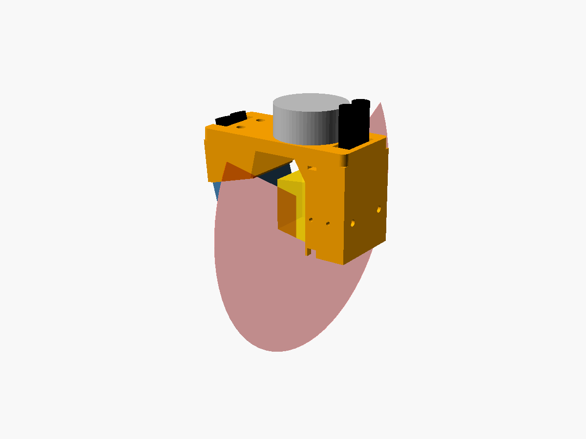
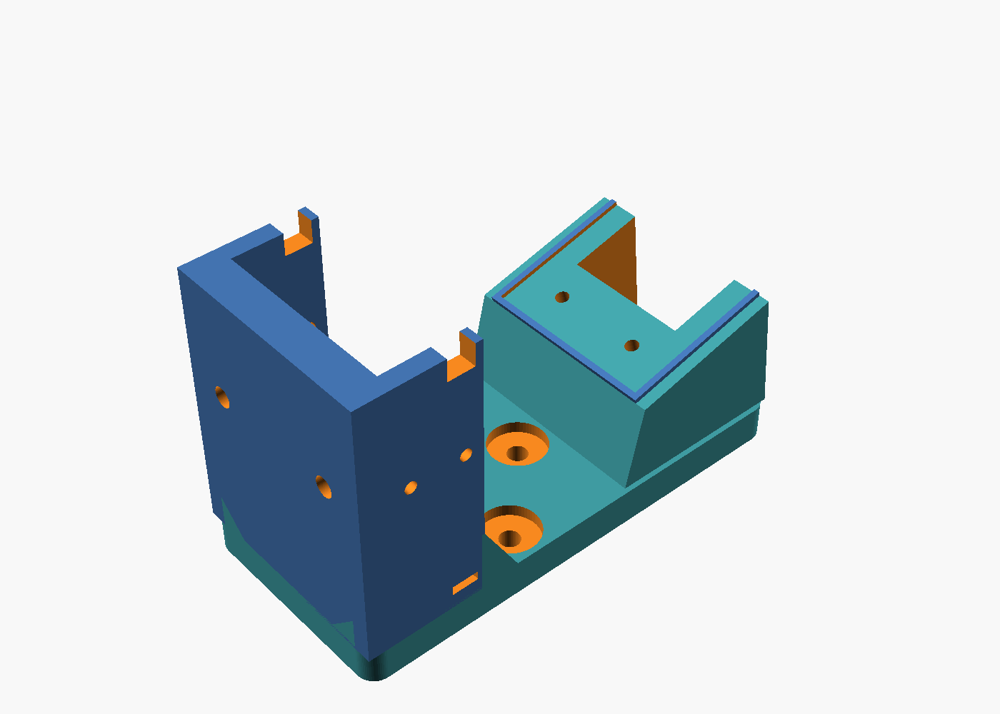
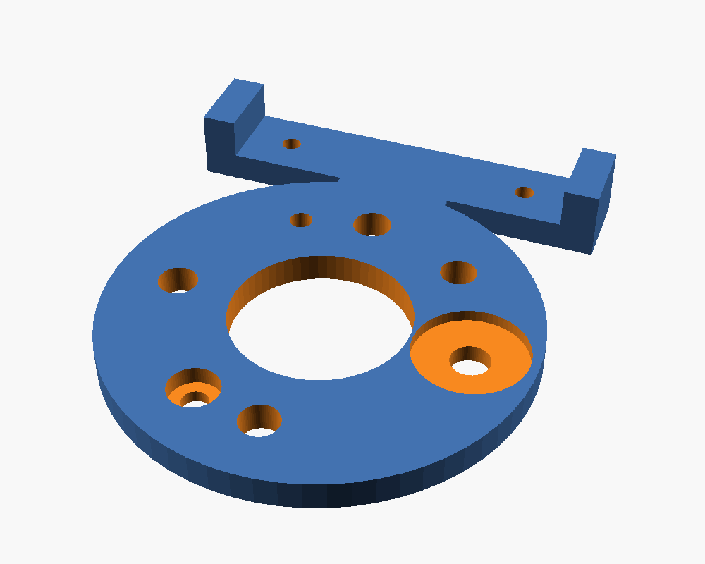
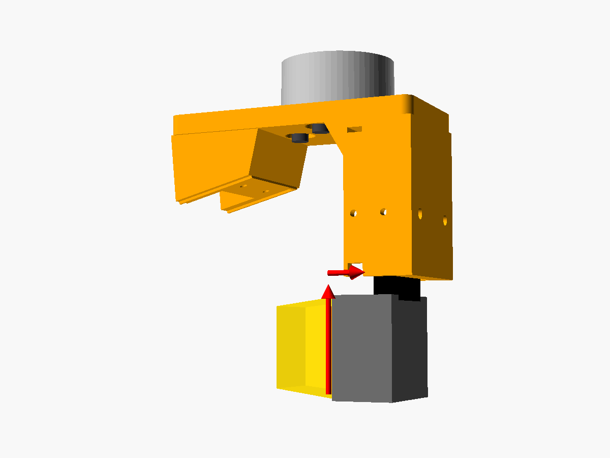
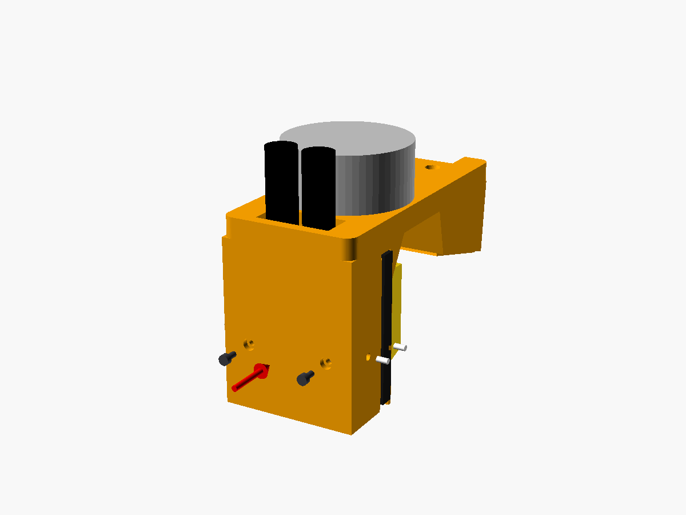
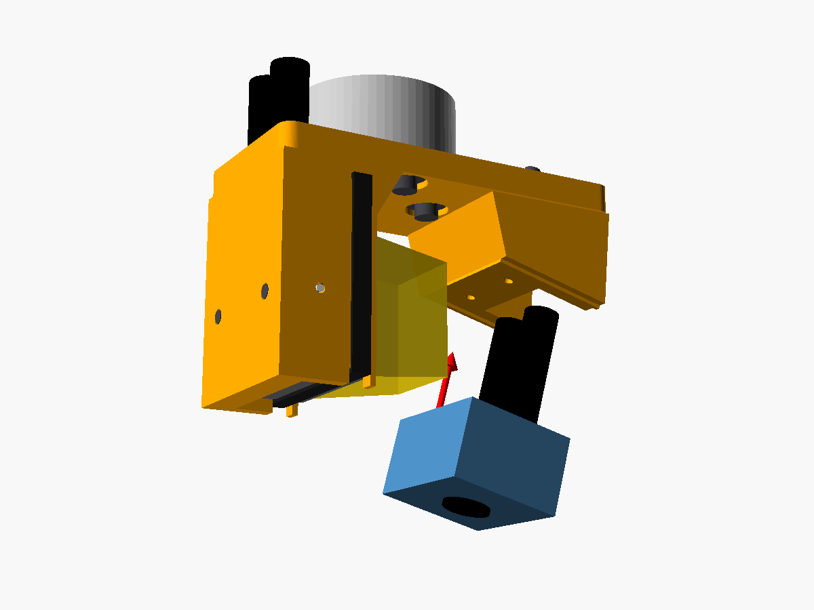

# TiM240 + SEC110 tool mount for the Lexium Cobot

This is a 3D-printable mount for the LXMRL03 tool flange (JAKA Zu 3: 4 × M6 on Ø50, Ø6 pin). It carries:
- a **SICK TiM240** 2D LiDAR (TiM240-2050300)
- a **SICK sensingCam SEC110** camera

The design is one parametric OpenSCAD file, [tim_sec_mount.scad](tim_sec_mount.scad). The printable STLs are in [stl/](stl/).

> **TiM240 only.** Before 15 Nov 2026 this mount was drawn for the larger TiM5xx/7xx (60 × 61 × 86 mm, M3 threads on its sides, scan plane 62.5 mm above the base). That version is in git history (commit `c27598a`), not in these files.


| From the camera end | From below (belt side) |
|---|---|
|  |  |

**How the TiM240 sits:**
- It lies **on its side**: its base faces −X and its hood +X (the direction of travel), its front face points down at the belt, and its back, with the connectors, points up at the arm.
- The TiM240 scans in a plane parallel to its base, so its **240° fan stands across the belt**, through the flange axis.
- Its 120° blind sector, around the connectors, faces the arm, so the fan never sees the robot.
- Its two M12 plugs come straight out of its back, next to the base. They go **up through a window in the plate**, beside the flange body (`check_tim_flange` confirms there's room).
- The scan origin is **X 0, Y 0, Z 64.75 mm** from the flange face. The app's Scan tab uses the same value for tool slot 1.

**The camera** sits on a solid block under the other end of the same part, looking down and tilted 15° back towards the scan line.



**One printed part holds both sensors**, and nothing relies on friction alone:
- **TiM240:** **2 × M3 screws through the base wall into the two threads in its base.** These are SICK's own mounting points. Around it is a box cradle:
  - side walls (±Y)
  - the base wall (−X)
  - a ledge under its front face at the base end (+Z)
  - back pads either side of the connector unit (−Z)

  There are also 4 nylon-tipped set screws against rattle, and a slot for a backup strap.
- **SEC110:** a seat with a locating rim on three sides, and 2 × M4 screws into the camera's back, driven from the top of the plate.

**Strength:** see the [structural analysis](analysis/README.md).

## Parts

| STL | Print | Time (Bambu A1 mini, sliced) |
|---|---|---|
| `fit_test.stl` | flat, no supports | 57 min. **Print this first.** |
| `mount.stl` | flange face on the bed (as exported), no supports | 9 h 57 min |

- **Material:** PETG, or ASA near heat. PLA works only with a solid plate and lower bolt torque (see the analysis), and not near heat.
- **Settings:** 0.2 mm layers, **6 walls**, 5 top and bottom layers, 50 % gyroid infill. Turn the cooling fan down so the layers bond well: the layers are the weak direction.
- **Bridges:** the only unsupported spans are the strap slot (9 mm), the ledge (6 mm out from the base wall, held on three sides) and small hole ceilings. They print without supports.
- **Holes:** they are drawn to size. If your printer prints holes small, ream the Ø6 pin hole and drill out the M6 holes.

## Ready-to-print project (Bambu Lab A1 mini)

[print/tim_sec_mount_A1mini_PETG.3mf](print/tim_sec_mount_A1mini_PETG.3mf) is a sliced Bambu Studio project with two plates. Print them in order:

| Plate | Part | Time | PETG |
|---|---|---|---|
| 1 | `fit_test.stl`: check the holes, and screw the TiM240 onto it, on the real arm first | 57 min | 22 g |
| 2 | `mount.stl`: the one-piece mount, flange face on the bed | 9 h 57 min | 248 g |

Those are the only two printed parts. Everything else is bought hardware: see [Hardware](#hardware).

**Qidi X-Max 3, Bambu Lab PLA, both parts on one plate:** [print/tim_sec_mount_QidiXMax3_PLA.3mf](print/tim_sec_mount_QidiXMax3_PLA.3mf), 10 h 1 min, 328 g.
- **Settings:** 0.20 mm layers, 6 walls, 5 top layers, 40 % gyroid infill, no supports, 220 °C, bed 60 °C, normal PLA cooling.
- **Solid plate:** 60 bottom layers, so the first 12 mm (the plate under the flange bolts) is solid. PLA slowly gives way under steady bolt pressure, and a solid plate keeps that pressure down.
- **Bolts in PLA:** tighten the M6 screws to **2 Nm, not 3**, and check them again after a day and after a week.
- **Heat:** keep the mount away from heat (above about 45 °C). On the X-Max 3, leave the chamber heater off and the lid or door open for PLA.

The profiles are `print/*QidiXMax3*.json` and `print/assemble_one_plate.json`.

**Settings:**
- Bambu Lab A1 mini, 0.4 mm nozzle, textured PEI plate.
- Bambu PETG Basic at 245 °C, bed at 70 °C.
- 0.20 mm layers, 6 walls, 5 top and bottom layers, 50 % gyroid infill, no supports.
- Part fan lowered to 15–30 % so the layers bond better.

The profiles are in `print/`. To slice again after a change, from this folder:

```bash
BambuStudio.AppImage --load-settings "print/machine_A1mini_0.4.json;print/process_strong_mount_A1M.json" --load-filaments print/filament_PETG_A1M_lowfan.json \
  --load-assemble-list print/assemble.json --curr-bed-type "Textured PEI Plate" --slice 0 --export-3mf print/tim_sec_mount_A1mini_PETG.3mf
```

The three profile files in `print/` are Bambu's system profiles with their `inherits` chains merged into one file each.

## Fit test: print it first



A 5 mm ring with the mount's flange holes, plus a gauge for the TiM240 in one piece. The gauge is a strip with the TiM's two base screw holes 44.4 mm apart (counterbored underneath), between two walls as far apart as the cradle's. It uses the same values as the mount, so if it fits, the mount fits. Print it in the same material and settings you'll use for the mount, then check:

| Check | Pass |
|---|---|
| Lay the ring on the flange, Ø6 dowel in the pin hole | all four M6 holes line up with the flange's threads; the dowel goes in by hand (snug, no wobble) |
| Screw in four M6 screws | they go in without forcing the ring sideways |
| Ø18 washer in the large counterbore | it drops in and sits flat |
| Look through the Ø30 centre hole | the flange's centring recess shows evenly all round (the ring is centred) |
| M3 insert in the plain Ø4 hole on the ring | it presses in straight and holds |
| M4 screw in the counterbored Ø4.4 hole | it passes freely and the head sits below the surface |
| Stand the TiM240 on the strip, base down, between the walls | it fits with a little play (0.4 mm a side) |
| Screw it on from underneath with 2 × M3 × 6 | both screws find the TiM's threads without forcing; that confirms the 44.4 mm spacing |

If a hole is tight, change `fl_bolt`, `fl_pin` or the insert sizes. If the TiM is tight or loose, change `clr`. Then export again and reprint the fit test before the mount.

## Hardware

| Qty | Part | Where |
|---|---|---|
| 4 | M6 × 16 socket head, 8.8 | mount to the flange: 8 mm of plastic under the washer, 6.4 mm into the flange's 7 mm threads. **3 Nm**, not the 11 Nm rated for metal tools. Medium threadlocker on the steel threads only. |
| 4 | M6 DIN 9021 washers (Ø18) | under the heads, in the Ø19 counterbores. They keep the pressure on the plastic down to 11 MPa, so it doesn't creep and loosen. |
| 1 | Ø6 × 16 dowel pin | in the pin hole: 7 mm in the plate, 9 mm in the flange. It sets the rotation. |
| 2 | M3 × 6 socket head | through the base wall into the TiM240's base threads (2.8 mm deep): 3 mm of plastic under the head, 2.6 mm into the TiM. **0.5 Nm** (SICK's maximum is 0.7 Nm). |
| 4 | M3 heat-set inserts (Ø4.0 hole) + M3 × 8 nylon-tipped set screws | in the side walls, against rattle: snug, not tight |
| 1 | cable tie or hook-and-loop strap, 8 mm wide | backup: through the slot above the TiM, round its front face |
| 2 | M4 × 8 socket head | SEC110 to its seat, from the top of the plate: 5 mm of plastic under the head, 3 mm into the camera. You need a long 3 mm hex key (the holes are about 45 mm deep). |
| 2 | **straight** M12 cables | SEC110: Ethernet (4-pin D-coded) and power/I/O (4-pin A-coded). They go up through the channel, which is open at the end. |
| 2 | **straight** M12 cables | TiM240: power (5-pin A-coded, female) and Ethernet (4-pin D-coded, male). They go up through the window in the plate. |

## Assembly

| 1. Bolt the mount to the flange | 2. TiM240: up from below, then back onto the ledge |
|---|---|
|  |  |
| **3. Base screws, set screws, strap** | **4. Camera: up into its rim, M4 screws from the top** |
|  |  |

`stl/assembly_view.3mf` opens the whole assembly in a slicer as one object with five parts: the mount, the flange, the TiM240 with its plugs, the camera, and the screws with the strap. It's for looking at only, so print `mount.stl`. Rebuild it with `analysis/make3mf.py` from the `p_*` parts of the .scad.

1. Press the four M3 inserts into the side walls.
2. Fit the dowel. Bolt the mount to the flange: 4 × M6 × 16 with the Ø18 washers, 3 Nm in a cross pattern. Do this first: the bolt heads are reached from below, before the sensors go in.
3. **TiM240:**
   - Hold it under the cradle, base towards the base wall, front face down, about 8 mm towards the camera end. Push it straight up until its back touches the pads; its connector unit goes up into the plate window.
   - Slide it back against the base wall, so its front face rests on the ledge.
   - Screw the two M3 × 6 through the base wall into its base (0.5 Nm), then snug the four set screws.
   - Thread the strap through the slot and round its front face.
   - The `check_insert` collision check confirms there's room for this path.
4. Plug the TiM240's two straight M12 cables in from above, through the plate window.
5. **SEC110:** plug in its straight M12 cables first. Lay them in the channel, set the camera into the rim (connectors towards the open end), and screw in the 2 × M4 × 8 from the top of the plate.
6. In the app: Scan tab → Scanner **TiM240**, then **scanner on the flange**. In the simulator that sets tool slot 1 (Z 64.75) and the payload: 0.55 kg, centre of mass X 13, Y 0, Z 44 mm. On the real cobot, enter the same values in Setup → Tool and Payload.

## Check before trusting it

- **Fan direction:** the bolt pattern is symmetric, so it doesn't say which way the robot's own tool X points. After mounting, jog in Tool X and check the arm moves along the TiM's base-to-hood axis. If not, add the difference to the pass **Direction**, or turn the tool frame.
- **Read from the drawing, not dimensioned:** three things come from reading SICK's drawing rather than from a printed dimension. The checks keep 2–3 mm of room around each, but measure your TiM240 against them:
  - the box part of the housing is about 36 mm tall before the hood narrows (the side walls stop at 34)
  - the scan axis sits at mid-depth, 29.75 mm from the back. If it's off, the scan origin moves by the same amount in Z; correct tool slot 1.
  - the connector unit is about 15 mm tall and 37 mm wide
- **TiM front face:** the ledge and the strap touch the front face near the base end. The TiM240's two status LEDs are on its front, near the base. Check you can still see them from the side, or move the strap.
- **No reflective surfaces:** SICK asks for none in a 30° zone behind the connectors. The plate there is matte printed plastic; keep shiny tape and labels off it.
- **Camera focus:** the SEC110's working distance starts at **0.3 m**. Its lens sits about 14 mm lower than the TiM's scan origin, so the Scan tab's default pass height of 330 mm keeps the belt just over 0.3 m away. Don't scan lower than about 320 mm if you need the camera image.
- **Not confirmed:** the SEC110 M4 thread depth (hence 3 mm of screw in it), and where the arm's M8 tool connector sits around the flange (it's on the side of joint 6, and the plate stays within 36 mm of the axis at Y).

## Collision checks

The .scad file has check parts that intersect two things that must never touch. Each must come out empty (OpenSCAD then says *Current top level object is empty*):

| Check | What must not touch |
|---|---|
| `check_tim` | the mount and the TiM240 (box, hood, connector unit and straight M12 plugs) |
| `check_tim_flange` | the TiM240's plugs and the arm's flange body (Ø68) |
| `check_cam_body`, `check_cam_plugs` | the mount and the camera body, or its straight M12 plugs |
| `check_cam_tim` | the camera and the TiM240 |
| `check_fan` | anything printed, or the camera, inside the TiM240's 240° fan |
| `check_insert`, `check_insert_cam` | the space the TiM sweeps going in (up from below, then back onto the ledge) and the mount or the camera |

All eight were empty for the files in `stl/` (15 Nov 2026). I also checked that they catch real collisions: with `slide=0`, `clr=-0.3`, or the plugs moved inwards, each reports one. Run them again after any change:

```bash
for p in check_tim check_tim_flange check_cam_body check_cam_plugs check_cam_tim check_fan check_insert check_insert_cam; do openscad --backend=manifold -D "part=\"$p\"" -o /tmp/$p.stl tim_sec_mount.scad 2>&1 | grep -q -i empty && echo "$p ok" || echo "$p COLLISION"; done
```

## Change it

Open the .scad in OpenSCAD and edit the values at the top: clearances, `gap`, `cradle_len`, `wall`, `cam_x`, `cam_drop`, `cam_tilt`. After a change, run the collision checks and update `analysis/params.json` before running the stress analysis again. To export one part:

```bash
openscad --backend=manifold -D 'part="mount"' -o stl/mount.stl tim_sec_mount.scad
```

Sources: Schneider Hardware Guide EIO0000004783 (pp. 41–42), SICK datasheet TiM240-2050300 (p. 4), SEC110-5C9D1SFZZZZ (p. 5).
