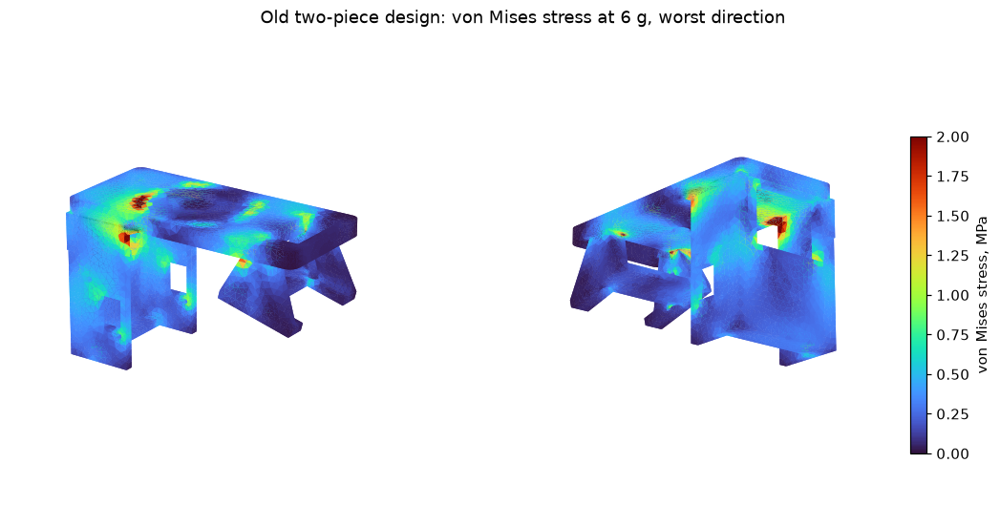
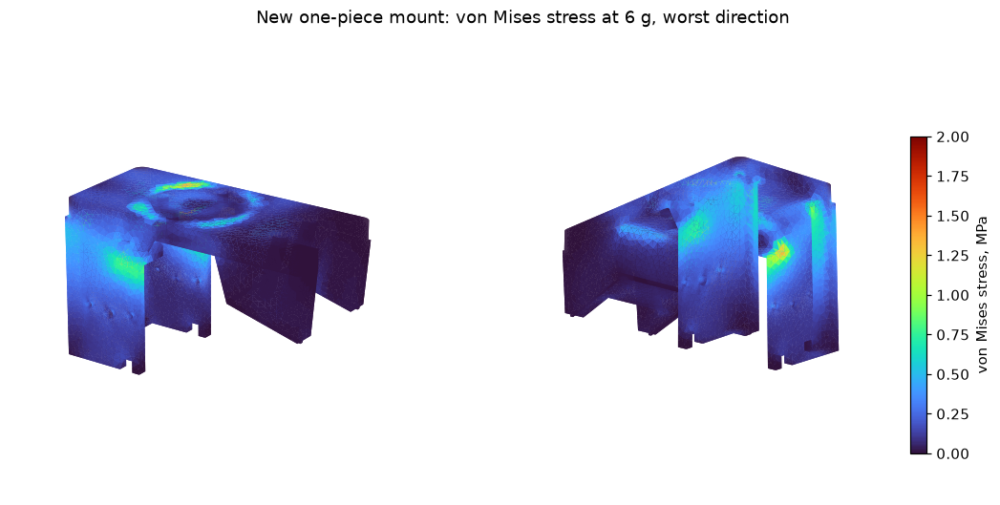

# Structural analysis: TiM + SEC110 mount

This compares the original two-piece design (a bracket plus a separate camera bracket) with the one-piece mount that replaced it. Both were run through the same finite-element model and the same load cases, and the fasteners were checked by hand. Analysis date: 14 Nov 2026.

**Result:** the one-piece mount is far stronger than it needs to be in the plastic. Its weak points are the fasteners, and those are sized below.

| | Old two-piece | **New one-piece** |
|---|---|---|
| Worst stress per g (von Mises) | 1.32 MPa | **0.29 MPa** (4.6× lower) |
| Load at which layers would separate | about 11 g | **about 43 g** |
| TiM movement, 1 g sideways (Y) | 59 µm, 0.044° | **20 µm, 0.012°** |
| Lowest natural frequency (estimate) | 68 Hz | **115 Hz** |
| Camera attachment | separate bracket on 2 × M4 inserts | **same part**: located by a rim, 2 × M4 into the camera |
| What holds the TiM | friction from 8 set screws | **positive stops on all sides**, 2 × M3 into its own threads, set screws, strap |
| Washer pressure from the flange bolts | 40–55 MPa (M6 head, 4 Nm): crushes and creeps | **11 MPa** (Ø18 washer, 3 Nm) |
| Printed mass (at about 80 % fill) | 184 g | 295 g |




Both plots show stress at 6 g in each design's own worst direction, on the same 0–2 MPa colour scale. Red is 2 MPa or more. The peak at 6 g is 7.9 MPa on the old design and 1.7 MPa on the new one.

## Loads

| Mass | kg | Centre of mass (flange frame, mm) |
|---|---|---|
| TiM 250 g + 100 g for its hanging cable | 0.35 | (−25, 0, 62.5) |
| SEC110 120 g + 80 g for cable | 0.20 | (63.7, 0, 62.2) |
| The printed part's own weight | 0.29 | spread through the part |

The cable allowances are deliberately generous. The arm can point the tool in any direction, so gravity was applied in every direction (sampled over a sphere), not just straight down.

| Case | Acceleration | What it represents | Compared against |
|---|---|---|---|
| Hanging | 1 g | the arm parked in any pose | creep (long-term) limits |
| Normal motion | 2.5 g (1 g + 1.5 g) | jogs and passes, millions of cycles | fatigue limits |
| Protective stop / jolt | 6 g (1 g + 5 g) | an emergency stop at full speed, or a bump | static strength |
| Wrist spin | 100 rad/s² about each axis | joint 6 reaching 180°/s in about 30 ms | static strength (all small: see the table below) |

## Material: PETG, printed flange-face-down

| Property | Value used | Note |
|---|---|---|
| Stiffness E | 1800 MPa, ν 0.38 | printed (a little below moulded PETG) |
| In-layer strength | 40 MPa | along the printed lines |
| **Between layers** | **15 MPa** (tension and shear) | the weak direction. This is conservative: well-tuned prints reach 20–30 MPa. |
| Fatigue (10⁷ cycles) | 25 % of strength: 10 / 3.75 MPa | |
| Creep (sustained) | 10 % of strength: 4 / 1.5 MPa | so the part doesn't sag over months |

Layers are Z slices (the flange face is on the bed). The between-layers check combines tension across the layers (σz) with shear along them: (σz/15)² + (τz/15)² ≤ 1.

## Safety factors (new design)

| Case | In-layer (von Mises) | Between layers |
|---|---|---|
| Hanging, 1 g, creep | 0.29 MPa vs 4 MPa: **14** | 0.023 / 0.1: **4.3** |
| Normal motion, 2.5 g, fatigue | 0.72 vs 10 MPa: **14** | 0.058 × 4 = 0.23: **4.3** |
| Protective stop, 6 g, strength | 1.7 vs 40 MPa: **23** | 0.14: **7.2** |

The old design, for comparison: normal-motion fatigue between layers came to a safety factor of **1.1**, and a protective stop to **1.8**. Its hot spot was where the separate camera bracket meets the plate. The model treats that joint as glued, but in reality it's two M4 screws in heat-set inserts, so the real old part was weaker than these numbers.

### Every case, per load (new / old)

| Load | Peak stress, MPa | TiM moves | TiM tilts | Camera moves |
|---|---|---|---|---|
| 1 g along X | 0.15 / 0.95 | 5 / 17 µm | 0.005 / 0.017° | 9 / 31 µm |
| 1 g along Y | 0.26 / 1.16 | 20 / 59 µm | 0.012 / 0.044° | 2 / 12 µm |
| 1 g along Z | 0.10 / 0.24 | 1 / 2 µm | 0.000 / 0.002° | 7 / 8 µm |
| 100 rad/s² about X | 0.19 / 0.63 | 14 / 41 µm | 0.009 / 0.031° | 2 / 8 µm |
| 100 rad/s² about Y | 0.14 / 0.57 | 4 / 14 µm | 0.005 / 0.014° | 11 / 25 µm |
| 100 rad/s² about Z | 0.06 / 0.82 | 5 / 11 µm | 0.002 / 0.007° | 1 / 7 µm |

## Scan accuracy and vibration

- **During scanning:** the arm moves gently (well under 1.5 g). The TiM moves less than 0.03 mm and tilts less than 0.02°. At a 330 mm range, that tilt shifts a point by about 0.1 mm, far below the TiM's own measurement error, which is in the tens of millimetres.
- **Vibration:** the lowest natural frequency estimate is 115 Hz (side to side), from the static deflection. That is well above the TiM's 15 Hz scan rate and the arm's own structural modes (tens of Hz), so the mount won't resonate during normal moves.

## Fasteners (hand calculations)

| Joint | Load at 6 g | Capacity | Notes |
|---|---|---|---|
| 4 × M6 × 16 (8.8) into the flange, DIN 9021 washers | about 60 N per bolt from the tipping moment | preload 2.5 kN per bolt at 3 Nm; 6.4 mm of thread in the 7 mm flange holes | Washer pressure is 11 MPa: low creep. **Use 3 Nm, not more.** Re-torque after 24 h, and use medium threadlocker on the steel threads only. |
| Bolted joint slip | about 50 N sideways | about 3 kN (friction from the preload) + Ø6 dowel | |
| 2 × M3 × 6 into the TiM's side threads | 0–21 N total | a 2.8 mm thread holds a few hundred N even in plastic | SICK's own mounting points. Max 0.8 Nm: use 0.5 Nm. |
| TiM ledges, pads, walls | carry the TiM in every direction | contact pressure < 0.1 MPa | the TiM can't fall out even if both screws are missing |
| 2 × M4 × 8 into the SEC110 (3 mm thread) | 12 N | over 1 kN | The rim takes the sideways load, not the screws. |
| Strap (cable tie or hook-and-loop) | backup | about 180 N (18 kg tie) | |

## What this doesn't cover

- **The model is simplified:**
  - The material is treated as linear and the same in every direction, with a separate check for the weak layer direction.
  - The sensors are modelled as glued to the faces they touch, with their load spread over those faces.
  - The flange is modelled as rigid over its contact ring (Ø31.5–63 mm). That holds because bolt preload keeps the joint closed far above these loads.
- **Peaks left out:** stress peaks in the elements that touch the clamp or the load faces are reported apart. They are artefacts of a rigid clamp and point loads, not real stresses.
- **Mesh and solver:** 153,000 quadratic tetrahedra (fTetWild mesh, scikit-fem solver). The solver was checked against a textbook cantilever: deflection within 1 %, stress within 6 % ([validate.py](validate.py)).
- **Version analysed:** the model was run on the mount just before a 2 mm strip was added under the camera rim, a printability fix. That fix only adds material.
- **Not modelled:**
  - Heat. PETG softens around 70 °C, so use ASA if the mount sits near hot equipment.
  - Print defects.
  - A crash into something. A crash can exceed 6 g by a lot, so the arm's collision detection should stay on.

## Run it again

You need OpenSCAD, then a Python venv with `pip install scikit-fem pytetwild pyvista trimesh pyamg matplotlib`. From this folder:

```bash
openscad --backend=manifold -D 'part="mount"' -o new1.stl ../tim_sec_mount.scad
python fea.py new1 new1.stl 4          # reads params.json (keep it in step with the .scad)
python plot.py new1 6 "New mount at 6 g" stress_new.png 2.0
openscad --backend=manifold -o old.stl old_union.scad && python fea.py old old.stl 4
```

It takes about 10 minutes per design on 12 cores.
